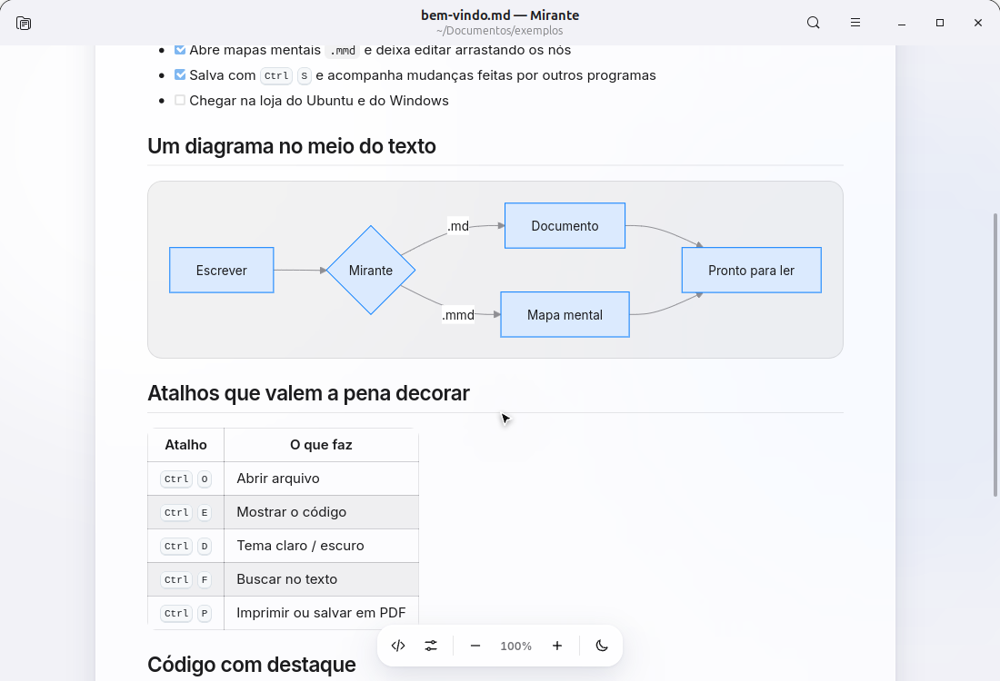
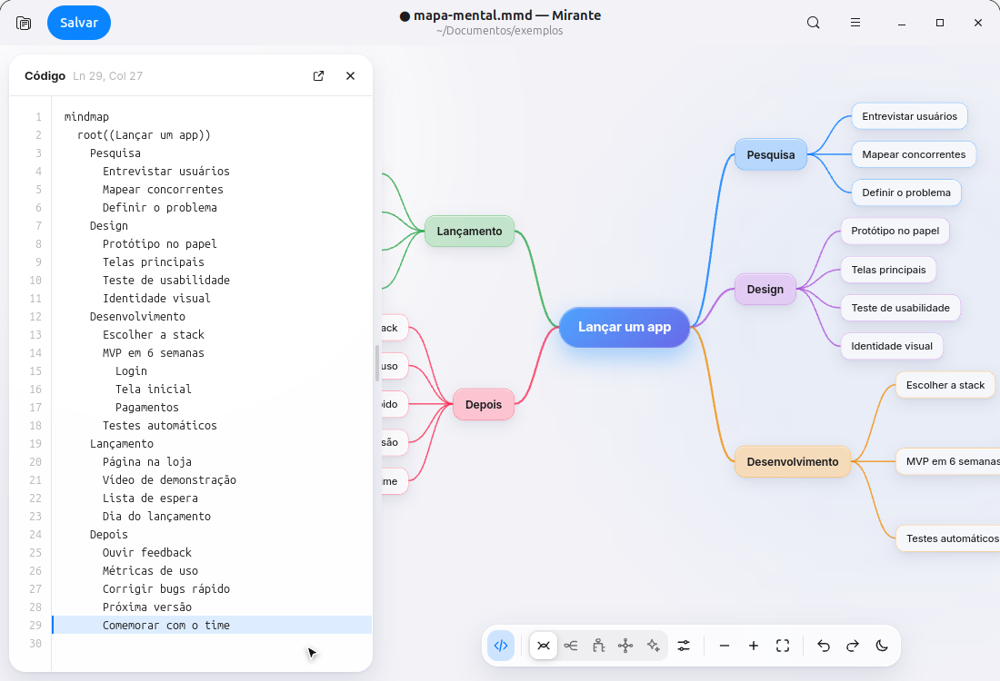
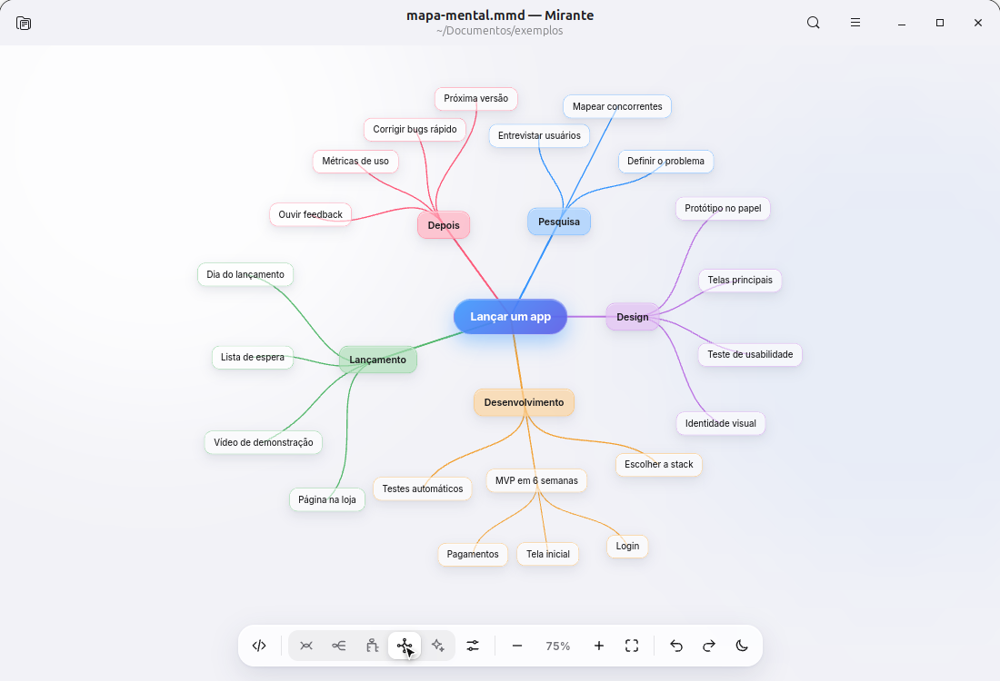

<div align="center">


# Mirante

**Visualizador e editor de Markdown e diagramas Mermaid e Graphviz para Windows e Linux**

[](https://github.com/joseRibamar21/mirante_md_mmd/actions/workflows/ci.yml)
[](https://github.com/joseRibamar21/mirante_md_mmd/releases/latest)
[](LICENSE)


[**Site do Mirante**](https://joseribamar21.github.io/mirante_md_mmd/) ·
[**Baixar para Windows**](https://github.com/joseRibamar21/mirante_md_mmd/releases/latest/download/Mirante-windows-x64-setup.exe) ·
[**Baixar para Linux (.deb)**](https://github.com/joseRibamar21/mirante_md_mmd/releases/latest/download/Mirante-linux-amd64.deb) ·
[Todas as versões](https://github.com/joseRibamar21/mirante_md_mmd/releases) ·
[Reportar um problema](https://github.com/joseRibamar21/mirante_md_mmd/issues)


</div>

O Mirante abre arquivos **Markdown** (`.md`) e diagramas **Mermaid** (`.mmd`) e **Graphviz** (`.gv`, `.dot`) com um visual limpo e
atualiza sozinho quando o arquivo muda no disco. Escreva no seu editor favorito e leia no Mirante, ou
edite direto nele: o painel de código fica ao lado e o desenho acompanha enquanto você digita.

## Recursos

- **Markdown completo**: tabelas, listas de tarefas, código com destaque de sintaxe, citações, links
  internos e diagramas Mermaid e Graphviz no meio do texto (blocos ` ```mermaid ` e ` ```dot `).
- **Diagramas do Markdown com controles próprios**: zoom, mover arrastando ou pelos botões e **expandir** em
  tela cheia sobre fundo escuro. Também dá para abrir um diagrama numa **janela só dele**, ligada ao `.md`:
  o que se edita lá volta para o bloco na hora, e <kbd>Ctrl</kbd> <kbd>S</kbd> salva o `.md`.
- **Feito para estudar**: fórmulas matemáticas e de química (`$...$`, `$$...$$`, `\ce{}`), caixas de
  destaque (`> [!TIP]`, `> [!WARNING]`...), perguntas com **resposta escondida** (`<details>`) e um **modo
  revisão** que mostra ou esconde todas de uma vez, e um **mapa mental gerado pelos títulos** do documento.
- **Gerar material com IA** (menu Ajuda): prompts prontos e um [guia de formato](docs/ia/guia.md) para o
  Claude, o ChatGPT ou o Gemini devolverem o material já no formato do Mirante.
- **Qualquer diagrama Mermaid** em arquivos `.mmd`: fluxogramas, sequência, Gantt, classes, estados e outros.
- **Grafos Graphviz** em arquivos `.gv` e `.dot`, com todos os motores de layout (`dot`, `neato`, `circo`,
  `twopi`, `fdp` e outros, escolhidos pelo atributo `layout` do grafo), sem precisar instalar o Graphviz.
- **Texto simples** em arquivos `.txt`: abre direto no editor, ocupando a janela, com busca (Ctrl+F) e
  salvamento como nos outros formatos.
- **Mapas mentais editáveis**: quatro layouts (dois lados, direita, vertical, radial) além do original do
  Mermaid; arraste um nó sobre outro para mudar de pai, renomeie com duplo clique e crie filhos e irmãos
  pelo teclado, com desfazer e refazer.
- **Editor ao lado** (<kbd>Ctrl</kbd> <kbd>E</kbd>) ou em janela separada (<kbd>Ctrl</kbd> <kbd>Shift</kbd> <kbd>O</kbd>),
  com o desenho atualizando ao vivo.
- **Sempre em dia com o disco**: salvou em outro programa, o Mirante redesenha na hora.
- **Tela inicial com os arquivos recentes**; links para outros `.md`/`.mmd`/`.gv` e arquivos arrastados para a
  janela abrem no próprio app.
- **Tema claro e escuro**, efeito de vidro e barra de controles que se esconde.
- **Em português e em inglês**: segue o idioma do sistema, ou escolha em **Exibir → Idioma (Language)**.
- **Zoom e movimento suaves a 60 fps**, com o modo de renderização escolhido pela sua placa de vídeo.
- **Buscar** no texto (<kbd>Ctrl</kbd> <kbd>F</kbd>), **exportar** o diagrama em SVG e **imprimir** ou salvar em PDF.

## Capturas

| | |
| :---: | :---: |
|  |  |
| Markdown com diagrama no meio do texto | Mapa mental com o código ao lado |
|  |  |
| Layout radial | Tema escuro |

<div align="center">
<br>
<sub>No Windows 11</sub>
</div>

## Instalação

### Windows 10 e 11

Baixe e rode o [**instalador**](https://github.com/joseRibamar21/mirante_md_mmd/releases/latest/download/Mirante-windows-x64-setup.exe)
(cerca de 3 MB; instala só para o seu usuário, sem pedir administrador). Ele registra o Mirante para abrir
arquivos `.md`, `.mmd` e `.gv`. Também há um [`.msi`](https://github.com/joseRibamar21/mirante_md_mmd/releases/latest/download/Mirante-windows-x64.msi)
para quem distribui em empresas.

A extensão `.dot` fica de fora do registro porque no Windows ela também é de modelos do Word; abra esses
arquivos pelo Mirante (<kbd>Ctrl</kbd> <kbd>O</kbd>, arrastando para a janela) ou por **Abrir com**.

> O instalador ainda não tem assinatura digital. Se o Windows mostrar "O Windows protegeu o computador",
> clique em **Mais informações → Executar assim mesmo**.

### Ubuntu 22.04+ e Debian 12+

```bash
wget https://github.com/joseRibamar21/mirante_md_mmd/releases/latest/download/Mirante-linux-amd64.deb
sudo apt install ./Mirante-linux-amd64.deb
```

Depois procure **Mirante** no menu de apps, ou abra um `.md`/`.mmd`/`.gv` pelo gerenciador de arquivos.
Para remover: `sudo apt remove mirante`.

## Atalhos

| Geral | | Mapa mental | |
| --- | --- | --- | --- |
| <kbd>Ctrl</kbd> <kbd>O</kbd> | Abrir arquivo | Clique | Selecionar nó |
| <kbd>Ctrl</kbd> <kbd>S</kbd> | Salvar | Duplo clique, <kbd>F2</kbd> | Renomear |
| <kbd>Ctrl</kbd> <kbd>E</kbd> | Mostrar o código | <kbd>Tab</kbd> | Adicionar filho |
| <kbd>Ctrl</kbd> <kbd>F</kbd> | Buscar no texto | <kbd>Enter</kbd> | Adicionar irmão |
| <kbd>Ctrl</kbd> <kbd>D</kbd> | Tema claro / escuro | <kbd>Delete</kbd> | Excluir nó e filhos |
| <kbd>F5</kbd> | Recarregar do disco | Setas | Navegar entre nós |
| <kbd>Ctrl</kbd> <kbd>Z</kbd> / <kbd>Ctrl</kbd> <kbd>Shift</kbd> <kbd>Z</kbd> | Desfazer / refazer | <kbd>Alt</kbd> <kbd>↑</kbd> <kbd>↓</kbd> | Mover entre irmãos |
| <kbd>Ctrl</kbd> <kbd>=</kbd> <kbd>−</kbd> <kbd>0</kbd> | Zoom | Arrastar nó sobre outro | Mudar de pai |
| <kbd>Ctrl</kbd> <kbd>1</kbd> | Ajustar à janela | Arrastar o fundo, roda | Mover o diagrama |
| <kbd>Ctrl</kbd> <kbd>P</kbd> | Imprimir / PDF | <kbd>Ctrl</kbd> + roda, pinça | Zoom |
| <kbd>Ctrl</kbd> <kbd>Shift</kbd> <kbd>E</kbd> | Exportar SVG | | |
| <kbd>Ctrl</kbd> <kbd>N</kbd> / <kbd>Ctrl</kbd> <kbd>W</kbd> | Nova janela / fechar | | |

A lista completa fica em <kbd>F1</kbd> dentro do app.

## Exemplos

A pasta [`exemplos/`](exemplos) tem um arquivo de cada tipo para experimentar:

| Arquivo | O que mostra |
| --- | --- |
| [`bem-vindo.md`](exemplos/bem-vindo.md) | Markdown com tabela, tarefas, código e um fluxograma no meio do texto |
| [`mapa-mental.mmd`](exemplos/mapa-mental.mmd) | Mapa mental para testar layouts, arrastar nós e editar |
| [`fluxograma.mmd`](exemplos/fluxograma.mmd) | Fluxograma com decisões e subgrupo |
| [`sequencia.mmd`](exemplos/sequencia.mmd) | Diagrama de sequência |
| [`arquitetura.gv`](exemplos/arquitetura.gv) | Grafo Graphviz com subgrupo e rótulos nas setas |

## Como funciona

O Mirante é feito com [Tauri 2](https://tauri.app): uma camada nativa pequena em Rust e uma página web que
desenha tudo. No Windows a página roda no WebView2 (o motor do Edge, que já vem no sistema); no Linux, no
WebKitGTK. Por isso o instalador tem poucos megabytes.

| Pasta / arquivo | Papel |
| --- | --- |
| `src-tauri/src/main.rs` | Janelas e menus, abrir/salvar, acompanhar o arquivo no disco, instância única, diálogos, idioma |
| `src-tauri/src/settings.rs` | Preferências e arquivos recentes |
| `src-tauri/src/hardware.rs` | Escolha do modo de renderização pela placa de vídeo |
| `web/viewer.html`, `viewer.js`, `viewer.css` | A página: Markdown, diagramas, editor, busca, zoom, animações e os textos em inglês |
| `web/mindmap.js` | Motor do mapa mental: leitura da sintaxe, layouts, desenho e edição |
| `docs/index.html` | O site ([joseribamar21.github.io/mirante_md_mmd](https://joseribamar21.github.io/mirante_md_mmd/)); depois de editar, rode `python3 scripts/gerar-site-en.py` para gerar a versão em inglês |
| `web/vendor/` | Mermaid, Graphviz (Viz.js), marked, DOMPurify, highlight.js e a fonte Inter ([licenças](web/vendor/LICENSES.md)) |
| `packaging/` | Ícone, atalho do menu, tipo `.mmd` e metainfo do Linux |

**Traduções.** O texto em português é a própria chave: na página, `tr("Salvar")` busca a versão
inglesa no dicionário `EN` do `viewer.js`; no Rust, `tr(app, "Salvar", "Save")`. Um texto novo na
interface precisa da versão em inglês nos dois lugares em que aparecer.

As preferências e a lista de recentes (só nome e caminho de cada arquivo) ficam em
`~/.config/mirante/settings.json` no Linux e em `%APPDATA%\mirante\settings.json` no Windows.

## Desenvolvimento

Precisa de [Node.js](https://nodejs.org) 18+ e [Rust](https://rustup.rs) estável. No Linux, também dos
pacotes de desenvolvimento do WebKitGTK; no Windows, das ferramentas de C++ do Visual Studio
([detalhes](https://tauri.app/start/prerequisites/)).

```bash
sudo apt install libwebkit2gtk-4.1-dev libxdo-dev librsvg2-dev build-essential   # só no Linux
npm install
npm run dev            # abre o app em modo de desenvolvimento
npm run build          # gera os instaladores em src-tauri/target/release/bundle/
cd src-tauri && cargo test
```

**Builds automáticos.** A cada push na `main` e em pull requests, o [CI](https://github.com/joseRibamar21/mirante_md_mmd/actions/workflows/ci.yml)
compila no Linux e no Windows, roda os testes, instala os pacotes em sistemas limpos (Windows, Ubuntu 22.04
e 24.04), abre o app e guarda os instaladores e capturas de tela como artefatos da execução.

**Publicar uma versão.** Atualize `version` em `src-tauri/Cargo.toml` e a seção `<releases>` em
`packaging/linux/io.github.mirante.Viewer.metainfo.xml`, faça o commit e envie uma tag com o mesmo número:

```bash
git tag v2.2.0
git push origin v2.2.0
```

O [workflow de release](.github/workflows/release.yml) confere a versão, gera os instaladores das duas
plataformas e cria a release com eles anexados.

## Próximos passos

- [x] Windows
- [ ] Snap Store (App Center do Ubuntu)
- [ ] Microsoft Store
- [ ] Flathub
- [ ] Assinatura digital do instalador do Windows

## Licença

[MIT](LICENSE) © José Ribamar. Os componentes de terceiros em `web/vendor/` mantêm as próprias
licenças, listadas em [`web/vendor/LICENSES.md`](web/vendor/LICENSES.md).
