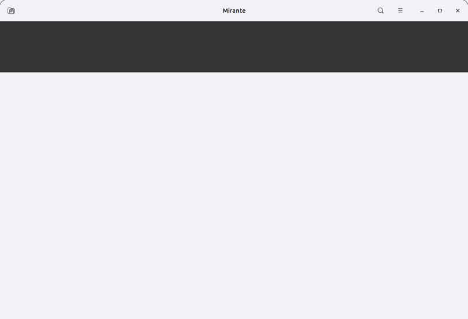
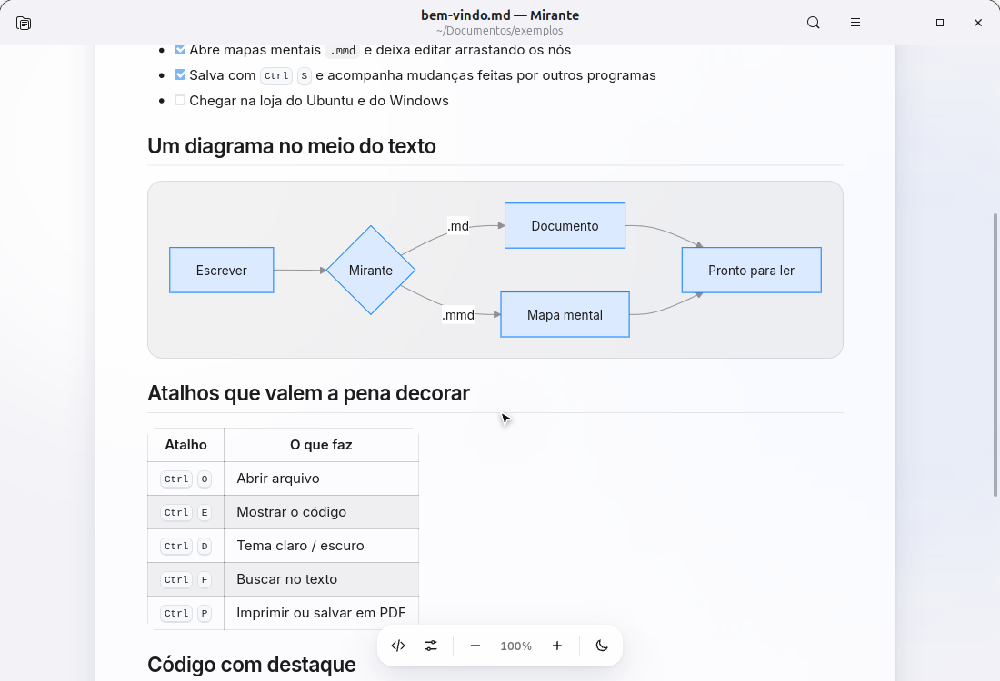
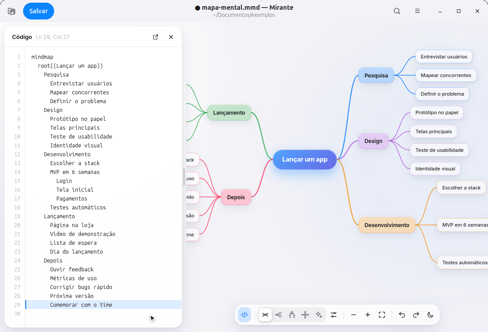
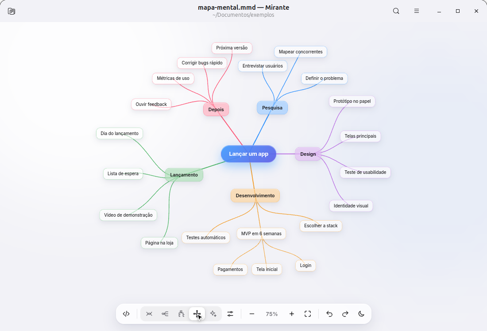
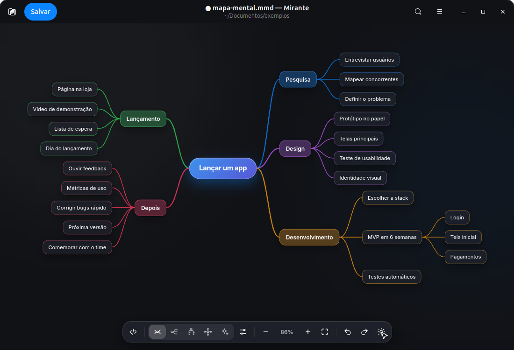

<div align="center">


# Mirante

**Visualizador e editor de Markdown e diagramas Mermaid para Linux**

[](https://github.com/joseRibamar21/mirante_md_mmd/actions/workflows/ci.yml)
[](https://github.com/joseRibamar21/mirante_md_mmd/releases/latest)
[](LICENSE)


[**Baixar o .deb**](https://github.com/joseRibamar21/mirante_md_mmd/releases/latest/download/mirante_all.deb) ·
[Todas as versões](https://github.com/joseRibamar21/mirante_md_mmd/releases) ·
[Reportar um problema](https://github.com/joseRibamar21/mirante_md_mmd/issues)



</div>

O Mirante abre arquivos **Markdown** (`.md`) e diagramas **Mermaid** (`.mmd`) com um visual limpo e
atualiza sozinho quando o arquivo muda no disco. Escreva no seu editor favorito e leia no Mirante, ou
edite direto nele: o painel de código fica ao lado e o desenho acompanha enquanto você digita.

## Recursos

- **Markdown completo**: tabelas, listas de tarefas, código com destaque de sintaxe, citações, links
  internos e diagramas Mermaid no meio do texto.
- **Qualquer diagrama Mermaid** em arquivos `.mmd`: fluxogramas, sequência, Gantt, classes, estados e outros.
- **Mapas mentais editáveis**: quatro layouts (dois lados, direita, vertical, radial) além do original do
  Mermaid; arraste um nó sobre outro para mudar de pai, renomeie com duplo clique e crie filhos e irmãos
  pelo teclado, com desfazer e refazer.
- **Editor ao lado** (<kbd>Ctrl</kbd> <kbd>E</kbd>) ou em janela separada (<kbd>Ctrl</kbd> <kbd>Shift</kbd> <kbd>O</kbd>),
  com o desenho atualizando ao vivo.
- **Sempre em dia com o disco**: salvou em outro programa, o Mirante redesenha na hora.
- **Tela inicial com os arquivos recentes**, e links para outros `.md`/`.mmd` abrem no próprio app.
- **Tema claro e escuro**, efeito de vidro e barra de controles que se esconde.
- **Zoom e movimento suaves a 60 fps**, com o modo de renderização escolhido pela sua placa de vídeo.
- **Exportar** o diagrama em SVG, **imprimir** ou salvar em PDF e **buscar** no texto.

## Capturas

| | |
| :---: | :---: |
|  |  |
| Markdown com diagrama no meio do texto | Mapa mental com o código ao lado |
|  |  |
| Layout radial | Tema escuro |

## Instalação

### Pacote .deb (Ubuntu 22.04+ e Debian 12+)

```bash
wget https://github.com/joseRibamar21/mirante_md_mmd/releases/latest/download/mirante_all.deb
sudo apt install ./mirante_all.deb
```

Depois procure **Mirante** no menu de apps, ou abra um `.md`/`.mmd` pelo gerenciador de arquivos e
escolha "Abrir com Mirante". Para remover: `sudo apt remove mirante`.

### A partir do código, sem sudo

Instala só para o seu usuário, em `~/.local`, e define o Mirante como app padrão para `.md` e `.mmd`:

```bash
sudo apt install python3-gi gir1.2-gtk-3.0 gir1.2-webkit2-4.1   # dependências, se ainda não tiver
git clone https://github.com/joseRibamar21/mirante_md_mmd.git
cd mirante_md_mmd
./mirante/install.sh               # --no-default: não muda o app padrão · --uninstall: remove
```

### Rodar sem instalar

```bash
python3 mirante/mirante.py exemplos/bem-vindo.md
```

## Atalhos

| Geral | | Mapa mental | |
| --- | --- | --- | --- |
| <kbd>Ctrl</kbd> <kbd>O</kbd> | Abrir arquivo | Clique | Selecionar nó |
| <kbd>Ctrl</kbd> <kbd>S</kbd> | Salvar | Duplo clique, <kbd>F2</kbd> | Renomear |
| <kbd>Ctrl</kbd> <kbd>E</kbd> | Mostrar o código | <kbd>Tab</kbd> | Adicionar filho |
| <kbd>Ctrl</kbd> <kbd>D</kbd> | Tema claro / escuro | <kbd>Enter</kbd> | Adicionar irmão |
| <kbd>Ctrl</kbd> <kbd>F</kbd> | Buscar | <kbd>Delete</kbd> | Excluir nó e filhos |
| <kbd>F5</kbd> | Recarregar do disco | Setas | Navegar entre nós |
| <kbd>Ctrl</kbd> <kbd>Z</kbd> / <kbd>Ctrl</kbd> <kbd>Shift</kbd> <kbd>Z</kbd> | Desfazer / refazer | <kbd>Alt</kbd> <kbd>↑</kbd> <kbd>↓</kbd> | Mover entre irmãos |
| <kbd>Ctrl</kbd> <kbd>+</kbd> <kbd>−</kbd> <kbd>0</kbd> | Zoom | Arrastar nó sobre outro | Mudar de pai |
| <kbd>Ctrl</kbd> <kbd>1</kbd> | Ajustar à janela | Arrastar o fundo, roda | Mover o diagrama |
| <kbd>Ctrl</kbd> <kbd>P</kbd> | Imprimir / PDF | <kbd>Ctrl</kbd> + roda, pinça | Zoom |
| <kbd>Ctrl</kbd> <kbd>Shift</kbd> <kbd>E</kbd> | Exportar SVG | | |

A lista completa fica em <kbd>F1</kbd> dentro do app.

## Exemplos

A pasta [`exemplos/`](exemplos) tem um arquivo de cada tipo para experimentar:

| Arquivo | O que mostra |
| --- | --- |
| [`bem-vindo.md`](exemplos/bem-vindo.md) | Markdown com tabela, tarefas, código e um fluxograma no meio do texto |
| [`mapa-mental.mmd`](exemplos/mapa-mental.mmd) | Mapa mental para testar layouts, arrastar nós e editar |
| [`fluxograma.mmd`](exemplos/fluxograma.mmd) | Fluxograma com decisões e subgrupo |
| [`sequencia.mmd`](exemplos/sequencia.mmd) | Diagrama de sequência |

## Como funciona

O Mirante é um app GTK 3 em Python. A janela usa uma WebView (WebKitGTK) para desenhar o conteúdo:

| Arquivo | Papel |
| --- | --- |
| `mirante/mirante.py` | Janela, arquivos (abrir, salvar, acompanhar mudanças), preferências e recentes |
| `mirante/viewer.html`, `viewer.js`, `viewer.css` | A página: Markdown, diagramas, editor, zoom e animações |
| `mirante/mindmap.js` | Motor do mapa mental: leitura da sintaxe, layouts, desenho e edição |
| `mirante/worker.html` | Renderiza diagramas Mermaid pesados numa WebView separada |
| `mirante/vendor/` | Mermaid, marked, DOMPurify, highlight.js e a fonte Inter ([licenças](mirante/vendor/LICENSES.md)) |

As preferências e a lista de recentes (só nome e caminho de cada arquivo) ficam em
`~/.config/mirante/settings.json`.

## Desenvolvimento

```bash
python3 mirante/mirante.py exemplos/mapa-mental.mmd   # rodar direto do código
packaging/build-deb.sh                                # gerar dist/mirante_<versão>_all.deb
```

**Builds automáticos.** A cada push na `main`, o [CI](https://github.com/joseRibamar21/mirante_md_mmd/actions/workflows/ci.yml)
verifica o código, gera o `.deb` (disponível como artefato da execução) e testa a instalação no Ubuntu
22.04 e 24.04.

**Publicar uma versão.** Atualize `APP_VERSION` em `mirante/mirante.py` e a seção `<releases>` em
`mirante/data/io.github.mirante.Viewer.metainfo.xml`, faça o commit e envie uma tag com o mesmo número:

```bash
git tag v2.1.0
git push origin v2.1.0
```

O [workflow de release](.github/workflows/release.yml) confere a versão, gera e testa o `.deb` e cria a
release com o pacote anexado.

**Regravar o GIF do README.** Os scripts em [`tools/demo/`](tools/demo) abrem o app, executam o roteiro
de [`demo.js`](tools/demo/demo.js) e montam `docs/demo.gif` e as capturas. Precisa de `ffmpeg` e Pillow:

```bash
python3 tools/demo/recorder.py /tmp/gravacao mirante exemplos
python3 tools/demo/make_gif.py /tmp/gravacao docs
```

## Próximos passos

- [ ] Snap Store (App Center do Ubuntu)
- [ ] Flathub
- [ ] Windows e Microsoft Store (exige trocar a camada GTK por uma multiplataforma, como Tauri)

## Licença

[MIT](LICENSE) © José Ribamar. Os componentes de terceiros em `mirante/vendor/` mantêm as próprias
licenças, listadas em [`mirante/vendor/LICENSES.md`](mirante/vendor/LICENSES.md).
