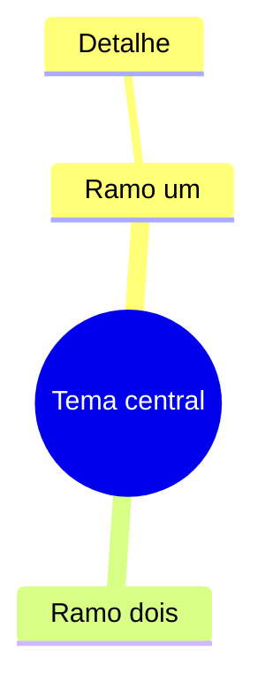

# Guia de formato do Mirante (para IAs)

O Mirante é um leitor de Markdown para estudo, gratuito e offline. Ele desenha fórmulas, diagramas, caixas de
destaque, perguntas com resposta escondida e um mapa mental a partir dos títulos. Siga estas regras ao gerar
material: tudo abaixo aparece formatado no Mirante e continua legível no GitHub, no VS Code e no Obsidian.

## Entrega

- Um único arquivo `.md` em UTF-8. Se você puder criar arquivos, entregue como arquivo para baixar.
- Se não puder, coloque o arquivo inteiro dentro de um bloco com **quatro crases** (` ````markdown `), para os
  blocos internos de três crases não quebrarem.
- Um mapa mental sozinho pode ser um arquivo `.mmd` só com o código Mermaid, sem crases.

## Estrutura

Os títulos viram o mapa mental do documento (botão na barra do Mirante), então:

- Um único `#` com o tema. `##` para cada tópico, `###` para subtópicos e no máximo `####`.
- Títulos curtos (até umas 6 palavras), sem fórmulas e sem pular níveis.
- Comece com um resumo curto numa caixa `> [!SUMMARY]`.
- Para material de revisão, termine com uma seção `## Revisão` de perguntas.

## Texto

- Parágrafos curtos, listas e **negrito** nos termos-chave. Tabelas para comparar.
- Código em blocos com a linguagem (` ```python `): ganha destaque de sintaxe.
- Listas de tarefas com `- [ ]` e `- [x]`.
- Imagens só por URL pública ou por arquivo na mesma pasta do `.md`.
- Links para outros `.md` abrem no próprio Mirante.

## Caixas de destaque

```markdown
> [!TIP] Macete
> Texto da dica. Todas as linhas da caixa começam com >.
```

- Tipos: `NOTE`, `TIP`, `IMPORTANT`, `WARNING`, `CAUTION`, `EXAMPLE`, `QUESTION` e `SUMMARY`.
- O título depois do tipo é opcional.
- `> [!QUESTION]- Pergunta` começa **fechada** e abre ao clicar; com `+` no lugar do `-`, começa aberta.

## Perguntas com resposta escondida

```markdown
**1.** Qual é a derivada de $\sin x$?

<details>
<summary>Ver resposta</summary>

É $\cos x$.

</details>
```

- As linhas em branco depois do `<summary>` e antes do `</details>` são obrigatórias: sem elas o conteúdo não é
  formatado.
- O Mirante tem um botão que mostra ou esconde todas as respostas (modo revisão).

## Fórmulas (KaTeX)

- No texto: `$...$`. Em destaque: `$$...$$` em linhas próprias. Também aceita `\(...\)` e `\[...\]`.
- Funciona: frações, raízes, somatórios, integrais, limites, matrizes (`pmatrix`, `bmatrix`), `cases`, `align`,
  `aligned`, `\text{}`, `\operatorname{}`, `\cancel{}`, `\boxed{}`, `\underbrace{}`, cores e química com `\ce{}` e
  `\pu{}`.
- Não funciona: `\label`, `\eqref`, `\ref`, `\SI` (siunitx), TikZ e `\usepackage`.
- Dinheiro: `R$ 10` (com espaço depois do `$`) aparece como texto. Evite `$5 e 10$`, que vira fórmula.
- Não ponha fórmulas nos títulos.

## Diagramas Mermaid

Em blocos ` ```mermaid `. Prefira vários diagramas pequenos (até uns 15 nós), um por ideia.

- Tipos que funcionam: `flowchart`, `sequenceDiagram`, `classDiagram`, `stateDiagram-v2`, `erDiagram`, `gantt`,
  `pie`, `mindmap`, `timeline`, `quadrantChart`, `xychart-beta`, `journey`, `gitGraph`, `sankey-beta`,
  `block-beta`, `kanban` e `C4Context`. Não funcionam: `radar` e `treemap`.
- Texto com parênteses, vírgulas ou dois-pontos vai entre aspas: `A["Texto (com) parênteses"]`.
- Não use `end` como nome de nó. Use ids curtos e sem acento (`A`, `deriv`); o acento vai no texto.
- Quebra de linha dentro do texto: `<br/>`.
- `classDiagram`: nome de classe sem acento, com o texto à parte: `class Cao["Cão"]`.
- Fórmula dentro do diagrama: `A["$$x^2$$"]`.
- Grupos: `subgraph id["Título do grupo"]` ... `end`.

Mapa mental (a indentação com espaços define a hierarquia; textos de até 5 palavras):



## Grafos Graphviz

Em blocos ` ```dot `: `digraph { rankdir=LR; a -> b -> c }`. O layout muda com `layout=neato`, `circo`,
`twopi` ou `fdp`.

## Notas de rodapé, citações e Obsidian

- Notas de rodapé: `texto[^1]` e, em qualquer lugar do arquivo, `[^1]: a nota`. Também `^[nota curta]`.
- Citações: `[@chave]` ou `[@chave, p. 10]`, com `bibliography: referencias.bib` no cabeçalho do arquivo. Só use se
  houver um `.bib`; não invente chaves.
- Do Obsidian: `[[outra nota]]`, `[[nota|apelido]]`, `![[imagem.png]]`, `==destaque==` e `#etiqueta` funcionam.

## O que não funciona
- HTML com `<script>`, `<iframe>` ou `<style>` (é removido), e embutir PDF ou vídeo.
- Atalhos de emoji como `:smile:`: use o próprio caractere.
