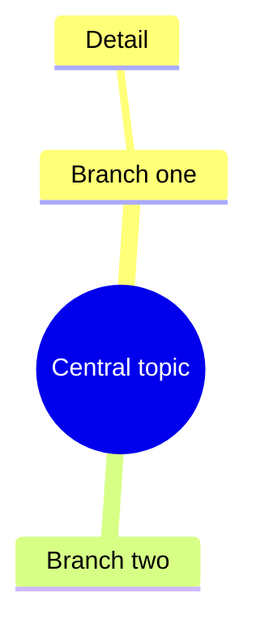

# Mirante format guide (for AIs)

Mirante is a free, offline Markdown reader for studying. It renders formulas, diagrams, callout boxes, questions
with hidden answers and a mind map built from the headings. Follow these rules when generating material:
everything below shows up formatted in Mirante and stays readable on GitHub, VS Code and Obsidian.

## Delivery

- A single UTF-8 `.md` file. If you can create files, deliver it as a downloadable file.
- If you can't, put the whole file inside a block with **four backticks** (` ````markdown `), so the inner
  three-backtick blocks don't break it.
- A standalone mind map can be a `.mmd` file with only the Mermaid code, without backticks.

## Structure

The headings become the document's mind map (a button on Mirante's bar), so:

- A single `#` with the subject. `##` for each topic, `###` for subtopics and `####` at most.
- Short headings (about 6 words at most), with no formulas and no skipped levels.
- Start with a short summary in a `> [!SUMMARY]` box.
- For review material, end with a `## Review` section of questions.

## Text

- Short paragraphs, lists and **bold** key terms. Tables to compare things.
- Code in blocks with the language (` ```python `): it gets syntax highlighting.
- Task lists with `- [ ]` and `- [x]`.
- Images only from a public URL or a file in the same folder as the `.md`.
- Links to other `.md` files open in Mirante itself.

## Callout boxes

```markdown
> [!TIP] Shortcut
> The tip's text. Every line of the box starts with >.
```

- Types: `NOTE`, `TIP`, `IMPORTANT`, `WARNING`, `CAUTION`, `EXAMPLE`, `QUESTION` and `SUMMARY`.
- The title after the type is optional.
- `> [!QUESTION]- Question` starts **closed** and opens on click; with `+` instead of `-`, it starts open.

## Questions with hidden answers

```markdown
**1.** What is the derivative of $\sin x$?

<details>
<summary>Show answer</summary>

It is $\cos x$.

</details>
```

- The blank lines after `<summary>` and before `</details>` are required: without them the content is not
  formatted.
- Mirante has a button that shows or hides every answer at once (review mode).

## Formulas (KaTeX)

- Inline: `$...$`. Display: `$$...$$` on their own lines. `\(...\)` and `\[...\]` also work.
- Supported: fractions, roots, sums, integrals, limits, matrices (`pmatrix`, `bmatrix`), `cases`, `align`,
  `aligned`, `\text{}`, `\operatorname{}`, `\cancel{}`, `\boxed{}`, `\underbrace{}`, colors and chemistry with
  `\ce{}` and `\pu{}`.
- Not supported: `\label`, `\eqref`, `\ref`, `\SI` (siunitx), TikZ and `\usepackage`.
- Money: `$ 10` (with a space after the `$`) stays as text. Avoid `$5 and 10$`, which becomes a formula.
- Don't put formulas in headings.

## Mermaid diagrams

In ` ```mermaid ` blocks. Prefer several small diagrams (up to about 15 nodes), one per idea.

- Supported types: `flowchart`, `sequenceDiagram`, `classDiagram`, `stateDiagram-v2`, `erDiagram`, `gantt`,
  `pie`, `mindmap`, `timeline`, `quadrantChart`, `xychart-beta`, `journey`, `gitGraph`, `sankey-beta`,
  `block-beta`, `kanban` and `C4Context`. Not supported: `radar` and `treemap`.
- Text with parentheses, commas or colons goes in quotes: `A["Text (with) parentheses"]`.
- Don't use `end` as a node name. Use short ids without accents (`A`, `deriv`); accents go in the text.
- Line break inside text: `<br/>`.
- `classDiagram`: class names without accents, with the text apart: `class Cafe["Café"]`.
- Formula inside a diagram: `A["$$x^2$$"]`.
- Groups: `subgraph id["Group title"]` ... `end`.

Mind map (indentation with spaces sets the hierarchy; texts of up to 5 words):



## Graphviz graphs

In ` ```dot ` blocks: `digraph { rankdir=LR; a -> b -> c }`. Change the layout with `layout=neato`, `circo`,
`twopi` or `fdp`.

## Footnotes, citations and Obsidian

- Footnotes: `text[^1]` and, anywhere in the file, `[^1]: the note`. Also `^[short note]`.
- Citations: `[@key]` or `[@key, p. 10]`, with `bibliography: references.bib` in the file's header. Only use them if
  there is a `.bib`; don't make up keys.
- From Obsidian: `[[another note]]`, `[[note|alias]]`, `![[image.png]]`, `==highlight==` and `#tag` work.

## What doesn't work
- HTML with `<script>`, `<iframe>` or `<style>` (it's removed), and embedding PDF or video.
- Emoji shortcodes like `:smile:`: use the character itself.
