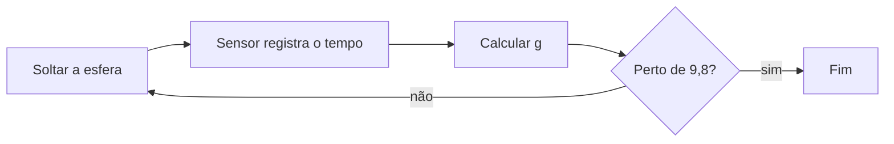

# Queda livre no laboratório

Física I · Ana Souza

---

## O que medimos

- A altura de queda de uma esfera
- O tempo de queda, com o sensor do celular
- E daí a aceleração da gravidade $g$

---

## O modelo

Sem resistência do ar, a posição é

$$
y(t) = y_0 - \frac{1}{2} g t^2
$$

e isolando $g$:

$$
g = \frac{2h}{t^2}
$$

---

## Como fizemos



---

## Resultados

| Altura (m) | Tempo (s) | $g$ (m/s²) |
|:--|:-:|--:|
| 0,50 | 0,320 | 9,77 |
| 1,00 | 0,452 | 9,79 |
| 1,50 | 0,553 | 9,81 |

> [!TIP] Conclusão
> A média, 9,79 m/s², fica a menos de 0,2% do valor de referência.

---

## O cálculo em Python

```python
alturas = [0.50, 1.00, 1.50]
tempos = [0.320, 0.452, 0.553]
g = [2 * h / t**2 for h, t in zip(alturas, tempos)]
print(sum(g) / len(g))
```

---

# Obrigado!

Perguntas?
