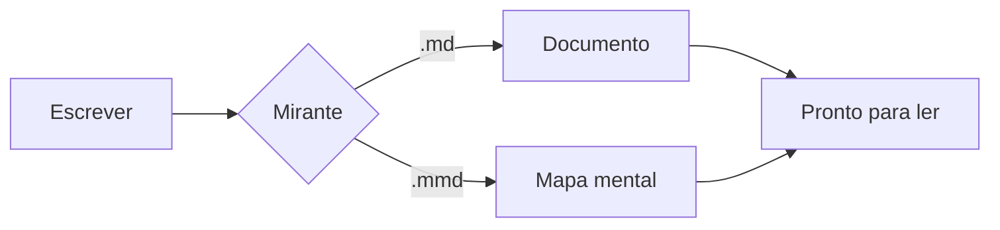

# Bem-vindo ao Mirante

O **Mirante** abre arquivos *Markdown* e diagramas **Mermaid** com um visual limpo,
e atualiza sozinho quando o arquivo muda no disco.

> **Dica:** aperte <kbd>Ctrl</kbd> <kbd>E</kbd> para abrir o código ao lado e editar ao vivo.

Links para outros arquivos `.md` e `.mmd` abrem no próprio Mirante, como este
[mapa mental de exemplo](mapa-mental.mmd).

## O que ele faz

- [x] Lê Markdown com tabelas, listas de tarefas e código com destaque
- [x] Desenha diagramas Mermaid no meio do texto
- [x] Abre mapas mentais `.mmd` e deixa editar arrastando os nós
- [x] Salva com <kbd>Ctrl</kbd> <kbd>S</kbd> e acompanha mudanças feitas por outros programas
- [ ] Chegar na loja do Ubuntu e do Windows

## Um diagrama no meio do texto



## Atalhos que valem a pena decorar

| Atalho | O que faz |
| --- | --- |
| <kbd>Ctrl</kbd> <kbd>O</kbd> | Abrir arquivo |
| <kbd>Ctrl</kbd> <kbd>E</kbd> | Mostrar o código |
| <kbd>Ctrl</kbd> <kbd>D</kbd> | Tema claro / escuro |
| <kbd>Ctrl</kbd> <kbd>F</kbd> | Buscar no texto |
| <kbd>Ctrl</kbd> <kbd>P</kbd> | Imprimir ou salvar em PDF |

## Código com destaque

```python
def saudacao(nome: str) -> str:
    """Devolve uma saudação simpática."""
    return f"Olá, {nome}! Bom te ver por aqui."


print(saudacao("Mirante"))
```

---

Feito para quem escreve em texto puro e quer ler com conforto.
