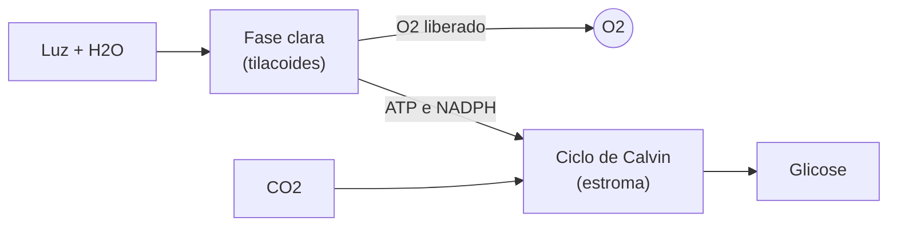

# Fotossíntese

> [!SUMMARY]
> A fotossíntese transforma luz, água e gás carbônico em glicose e oxigênio.
> Acontece nos cloroplastos, em duas etapas: a fase clara e o ciclo de Calvin.
> É a base de quase toda a energia dos seres vivos.

## Equação geral

A reação resumida é:

$$
\ce{6CO2 + 6H2O ->[luz][clorofila] C6H12O6 + 6O2}
$$

> [!WARNING] Erro comum
> O oxigênio liberado vem da **água**, não do $\ce{CO2}$. Isso foi mostrado com água marcada com $\ce{^{18}O}$.

## Onde acontece

| Parte do cloroplasto | O que acontece |
| --- | --- |
| Tilacoides | Fase clara: luz vira ATP e NADPH |
| Estroma | Ciclo de Calvin: $\ce{CO2}$ vira glicose |

## As duas etapas

### Fase clara

A clorofila absorve a luz e quebra a água (fotólise):

$$
\ce{2H2O -> 4H+ + 4e- + O2}
$$

### Ciclo de Calvin

Usa o ATP e o NADPH da fase clara para fixar o carbono. A cada 6 voltas forma uma glicose.

> [!TIP] Macete
> **Clara** produz energia (ATP, NADPH); **Calvin** gasta energia para montar glicose.

## Revisão

**1.** Qual é a origem do oxigênio liberado na fotossíntese?

Ver resposta

A **água**, quebrada na fotólise durante a fase clara: $\ce{2H2O -> 4H+ + 4e- + O2}$.

**2.** Em que parte do cloroplasto acontece o ciclo de Calvin?

Ver resposta

No **estroma**.

**3.** Quantas moléculas de $\ce{CO2}$ são fixadas para formar uma glicose?

Ver resposta

Seis, uma por volta do ciclo: $6\ \ce{CO2} \rightarrow \ce{C6H12O6}$.

> [!QUESTION]- Desafio: por que a fotossíntese para no escuro, se o ciclo de Calvin não usa luz?
> Porque o ciclo de Calvin depende do ATP e do NADPH produzidos na fase clara. Sem luz, eles acabam em poucos
> segundos e o ciclo para junto.
